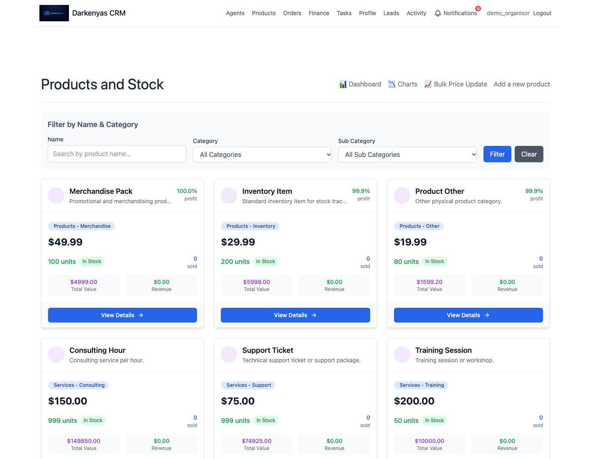

# Darkenyas CRM

A Django CRM for managing leads, agents, products, stock, orders and finances across organisations. Administrators oversee the system, organisors manage their organisation, and agents work with assigned records.

[Live demo](https://darkenyas-crm.onrender.com/)



## Features

- **Organisation and team management:** administrator, organisor and agent roles, with organisation and assignment filters for business records.
- **Lead management:** create and update customer records, assign agents, classify leads by source and value, upload photos, and review activity history.
- **Products and inventory:** categories, stock movements, minimum stock levels, price history, discounts, bulk price changes, stock alerts and recommendations, plus sales dashboards and charts.
- **Orders and finance:** orders with multiple product lines, stock deductions on creation and restoration on cancellation, and date-filtered revenue, cost and profit reports.
- **Tasks and notifications:** assign work, track status and priority, and receive in-app updates. Management commands provide task deadline emails, delivery-day reminders and follow-ups for inactive leads when scheduled separately.
- **Accounts and activity:** email verification, login by username or email, password reset, profile editing, and activity logs for changes to business records.

## Tech Stack

- **Backend:** Python 3.12, Django 5.2 LTS, Django Crispy Forms and crispy-tailwind.
- **Frontend:** Django templates, Tailwind CSS, Chart.js and Flatpickr; no Node.js build step.
- **Database:** SQLite for a minimal local setup, or PostgreSQL through psycopg and dj-database-url.
- **Email and uploads:** Gmail SMTP or Gmail API; local file storage or Cloudflare R2.
- **Serving:** Gunicorn and WhiteNoise; a Render Blueprint is included.

## Local Setup

Use **Python 3.12** and Git. The upload validator uses `imghdr`, which was removed in Python 3.13. PostgreSQL is needed only if you choose it instead of SQLite.

Run the following commands from the repository root after cloning.

### 1. Clone and create a virtual environment

```bash
git clone https://github.com/BerkAkidil9/Crm-Example.git
cd Crm-Example
python3.12 -m venv .venv
source .venv/bin/activate
```

On Windows, create the environment with `py -3.12 -m venv .venv` and activate it with `.venv\Scripts\activate.bat` in Command Prompt or `.venv\Scripts\Activate.ps1` in PowerShell.

### 2. Install dependencies and configure the environment

```bash
python -m pip install -r requirements.txt
cp .env.example .env
```

On Windows, use `copy .env.example .env` in Command Prompt or `Copy-Item .env.example .env` in PowerShell.

Edit `.env` before starting:

- Replace `SECRET_KEY` with the output of `python -c "import secrets; print(secrets.token_urlsafe(50))"`.
- Keep `DEBUG=True` for local development.
- For **SQLite**, change `DB_ENGINE` to `django.db.backends.sqlite3` and leave `DATABASE_URL` unset. SQLite requires no database server.
- For **PostgreSQL**, keep the example's `DB_ENGINE=django.db.backends.postgresql`, create the database, and set `DB_NAME`, `DB_USER`, `DB_PASSWORD`, `DB_HOST` and `DB_PORT`. Set `DB_SSL=true` if your database requires TLS.

Database selection is `DATABASE_URL` first, then `DB_ENGINE`/`DB_*`, then SQLite if neither is set. The example file selects PostgreSQL. Settings read the root `.env` with `override=True`, so its values override existing environment variables.

Account verification, invitations and password reset require working email settings; see [Email Configuration](#email-configuration). Leave `USE_R2=false` to keep local uploads in `media/`.

### 3. Initialise the database and run

For PostgreSQL, create the configured database first, for example `createdb djcrm` with a PostgreSQL account that can create databases. Then run:

```bash
python manage.py migrate
python manage.py createsuperuser
python manage.py runserver
```

Open **http://127.0.0.1:8000/**. The superuser can log in without email verification. Django administration is available at **http://127.0.0.1:8000/admin/**.

### 4. Start using the CRM

1. Sign in as the administrator and create an organisor through the Organisors screen.
2. Complete email verification for that account, then sign in as the organisor to manage its agents and leads.
3. Create product categories before adding products. To populate a development organisation with sample products, run:

   ```bash
   python manage.py create_categories
   python manage.py create_sample_products --username ORGANISOR_USERNAME
   ```

   Replace `ORGANISOR_USERNAME` with the organisor account you created. The sample command skips products that already exist and categories it cannot find.

4. Create orders for leads, review inventory and financial reports, and assign tasks to team members.

## Email Configuration

For **local Gmail SMTP**, set `USE_GMAIL_API=false`, `EMAIL_HOST_USER`, `EMAIL_HOST_PASSWORD` and `DEFAULT_FROM_EMAIL` in `.env`. Use a Gmail App Password from an account with two-step verification. The SMTP host, port and TLS setting are fixed in `djcrm/settings.py`.

For **Gmail API**, set `USE_GMAIL_API=true` and configure `GMAIL_API_CLIENT_ID`, `GMAIL_API_CLIENT_SECRET`, `GMAIL_API_REFRESH_TOKEN` and `DEFAULT_FROM_EMAIL`. Follow the [Gmail API guide](docs/GMAIL_API_SETUP.md) for the OAuth setup and a test email.

The application also selects Gmail API whenever `RENDER_EXTERNAL_HOSTNAME` is present. Render's free web services block outbound SMTP ports, so the included free-service Blueprint uses Gmail API.

## Testing

From the project root, with dependencies installed and the development environment configured:

```bash
python manage.py test
```

Django discovers the tests under the eight application packages. They cover models, forms, views, authentication, role and organisation filters, signals and management commands. The test command selects an in-memory SQLite database, disables rate limiting and uses Django's test email backend. It does not verify PostgreSQL behaviour, real email delivery, R2 access or browser interactions.

For checks in a separate checkout **without a `.env` file**, install `requirements-dev.txt` and run:

```bash
python -m pip install -r requirements-dev.txt
python scripts/ci.py
```

This runs the dependency audit, Django checks, production configuration checks, migration consistency checks, static collection and tests. Database, email, media and static outputs use disposable settings. Use `python scripts/ci.py test` to run only the tests.

## Deployment

[render.yaml](render.yaml) defines a Python web service using Gunicorn. Create a Render **Blueprint** from the repository and supply a PostgreSQL database through `DATABASE_URL`.

| Setting | Purpose |
| --- | --- |
| `DATABASE_URL` | PostgreSQL connection URL; the URL configuration requires SSL. |
| `SECRET_KEY` | Generated by the Blueprint, or set to a strong secret. |
| `DEBUG=False` | Production mode; set by the Blueprint. |
| Gmail API variables | Configure the four email values described above; the Blueprint sets `USE_GMAIL_API=true`. |
| `ALLOWED_HOSTS`, `CSRF_TRUSTED_ORIGINS`, `SITE_URL` | Set for a custom domain. The Render hostname is added automatically; trusted origins include the URL scheme. |
| R2 variables | Optional persistent upload storage; see the [R2 guide](docs/CLOUDFLARE_R2.md). |

[build.sh](build.sh) installs dependencies, collects static files, applies migrations and attempts to create a superuser using `DJANGO_SUPERUSER_USERNAME`, `DJANGO_SUPERUSER_EMAIL` and `DJANGO_SUPERUSER_PASSWORD` if supplied. Its final `createsuperuser` failure is ignored, so verify administrator access after deployment. For an existing database, back it up before applying migrations.

To collect static assets separately:

```bash
python manage.py collectstatic --noinput
```

There is no frontend compilation step. The build script changes the configured database; use it with the intended deployment settings. `/healthz/` returns `ok` but does not check database or external-service connectivity.

Render's local disk is ephemeral. Configure R2 for persistent uploads; switching storage does not migrate existing files. Local `/media/` serving is for debug mode, so production uploads need R2 or a separately configured media server.

### Scheduled notifications

The Blueprint does not define a cron service. Configure a scheduler separately, using the same database and environment as the web service. The available notification commands are:

```bash
python manage.py check_task_deadlines
python manage.py check_order_day
python manage.py check_lead_no_order
```

Run them daily if you want deadline reminders, delivery-day notifications and inactive-lead follow-ups. `check_task_deadlines --dry-run` previews deadline emails without sending them. These commands are separate from deployment and tests.

## Project Structure

```text
djcrm/             Project settings, URLs, WSGI/ASGI and media proxy
leads/             Accounts, leads, organisation profiles and the Agent model
agents/            Agent management forms, views and templates
organisors/        Organisor management
ProductsAndStock/  Products, categories, inventory and sales dashboards
orders/            Orders and product lines
finance/           Financial reporting
tasks/             Tasks, notifications and reminder commands
activity_log/      Business activity records
templates/         Shared layout, landing and authentication templates
static/            Styles, JavaScript and favicon
docs/              Integration guides, screenshots and historical analysis
scripts/           Isolated project checks
```

Each application keeps its models, forms, views, URLs, migrations, templates and tests together. Edit shared navigation and page layout in `templates/`; business screens are in each application's `templates/` directory. Keep the existing `ProductsAndStock` spelling when referencing that application.

## Documentation

- [Gmail API setup](docs/GMAIL_API_SETUP.md)
- [Cloudflare R2 storage](docs/CLOUDFLARE_R2.md)
- [Historical repository and test metrics, in Turkish](docs/CV_METRICS_ANALYSIS_TR.md) — dated measurements with their original evidence and limits.

## License

[MIT](LICENSE).
